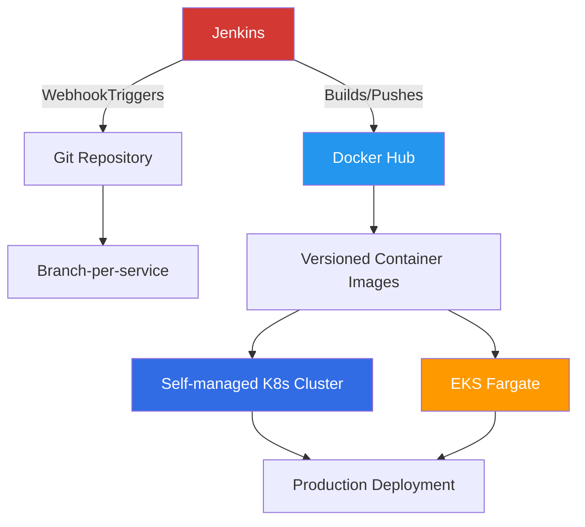
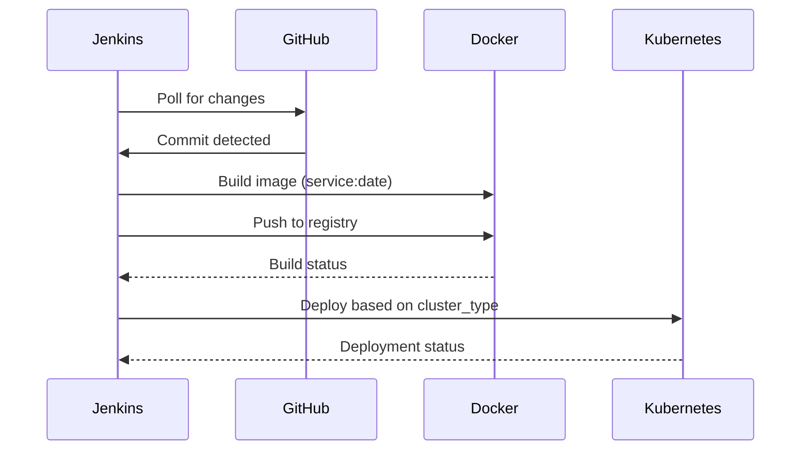
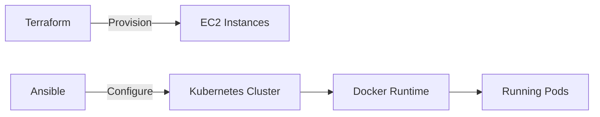
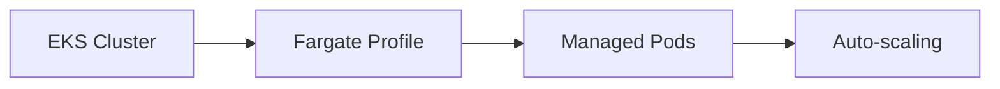

# AWS Microservices CI/CD Pipeline Project


A complete CI/CD pipeline implementation for microservices on AWS, featuring Jenkins automation, Docker containerization, and multiple deployment strategies with both self-managed Kubernetes and EKS.

## Table of Contents
- [Project Overview](#project-overview)
- [Architecture](#architecture)
- [Implementation Highlights](#implementation-highlights)
- [Getting Started](#getting-started)
- [Pipeline Workflow](#pipeline-workflow)
- [Infrastructure Options](#infrastructure-options)
- [Roadmap](#roadmap)
- [License](#license)

## Project Overview

This project implements a production-grade CI/CD pipeline for microservices with:

- **Branch-per-service** strategy (12 microservices in separate branches)
- **Automated Jenkins pipelines** for each service
- **Docker Hub integration** with versioned tagging
- **Dual deployment options**:
  - Self-managed Kubernetes (Terraform + Ansible)
  - AWS EKS with Fargate
- **Extensible architecture** for additional cloud providers

## Architecture



## Implementation Highlights

### Branch Structure
```
main/                   # Baseline application
├── cart-service/       # Branch: cart
├── checkout-service/   # Branch: checkout
├── currency-service/   # Branch: currency
├── email-service/      # Branch: email
├── frontend/           # Branch: frontend
├── payment-service/    # Branch: payment
└── ... (12 services total)
```

### Infrastructure Options

1. **Self-managed Kubernetes**:
   - Terraform-provisioned EC2 instances
   - Ansible-configured K8s cluster
   - Custom networking and storage

2. **AWS EKS with Fargate**:
   - Serverless container execution
   - Auto-scaling built-in
   - Reduced operational overhead

## Getting Started

### Prerequisites
- AWS Account with IAM permissions
- Jenkins 2.346+ with Blue Ocean plugin
- Docker Hub account
- Terraform 1.2+
- Ansible 2.12+

## Pipeline Workflow

### Current Implementation


### Tagging Convention
| Environment  | Tag Format              | Example               |
|--------------|-------------------------|-----------------------|
| Development  | `service:YYYYMMDD`      | `frontend:20240531`   |
| Production   | `service:semver`        | `cart:1.2.0`          |

## Infrastructure Options

### Option 1: Self-managed K8s


### Option 2: EKS Fargate


## Roadmap

### Immediate Priorities
- [x] Jenkins pipeline for image building
- [x] Terraform EKS infrastructure
- [x] Self-managed K8s option

### Future Enhancements
- [ ] Image vulnerability scanning (Trivy integration)
- [ ] Unit testing stage in pipeline
- [ ] Blue-green deployment strategy
- [ ] CloudWatch monitoring dashboard
- [ ] Multi-region deployment

## License
Apache License 2.0 (inherited from original GoogleCloudPlatform/microservices-demo)
